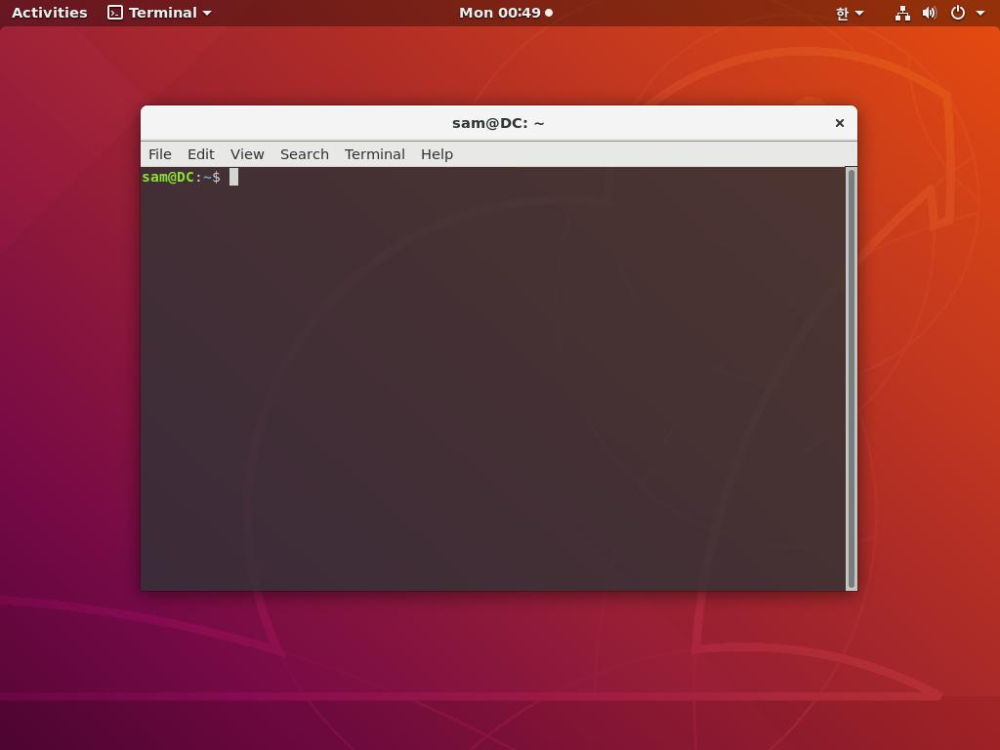
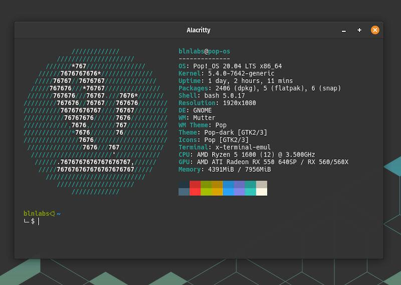
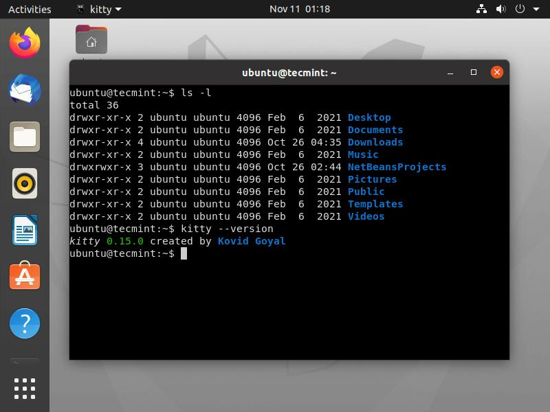
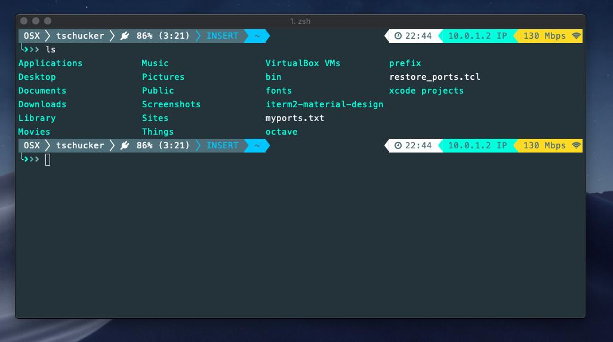

---
title: 2.7 Terminal Emulators
description: How terminal emulators interpret escape sequences and render text on screen.
---

In the previous section, we followed the journey of text as it traveled from `stdout` through the operating system toward the user's terminal.

One important question remains:

> **What actually displays the text on the screen?**

The answer is **the terminal emulator**.

Every time you open a terminal window on your desktop, you are launching a terminal emulator. It is the application responsible for receiving a stream of characters from the operating system and rendering them as visible text inside a graphical window.

Our text editor will run _inside_ a terminal emulator. Chapter 3 will explore terminal emulators in depth — covering their architecture, relationship with pseudo-terminals (PTYs), responsibilities for keyboard input and ANSI escape sequence interpretation, and the full terminal session lifecycle. For now, we introduce the concept and survey the major implementations.

## What Is a Terminal Emulator?

A **terminal emulator** is a program that simulates the behavior of a traditional computer terminal within a graphical operating system.

Instead of drawing its own user interface using buttons, menus, and windows, a terminal application communicates by sending characters and control sequences. The terminal emulator interprets those bytes and updates the display accordingly.

```text
Application

    │
    ▼

Character Stream

    │
    ▼

Terminal Emulator

    │
    ▼

Rendered Window
```

The application never draws pixels directly. Instead, it sends instructions in the form of characters and control sequences, and the terminal emulator converts those instructions into a visible interface.

## Common Terminal Emulators

Many terminal emulators are available today. Although they differ in appearance, performance, and additional features, they all serve the same fundamental purpose: receiving character streams and rendering a terminal interface.

### GNOME Terminal



**GNOME Terminal** is the default terminal emulator for many Linux distributions that use the GNOME desktop environment.

It integrates closely with the desktop, supports multiple tabs, profiles, Unicode, colors, and modern terminal features, making it a common choice for Linux users.

### Windows Terminal


**Windows Terminal** is Microsoft's modern terminal application.

Unlike the older Windows Console, it supports multiple tabs, Unicode, customizable themes, GPU-accelerated rendering, and multiple command-line environments such as PowerShell, Command Prompt, and the Windows Subsystem for Linux (WSL).

### Alacritty



**Alacritty** is a lightweight terminal emulator focused on speed.

It uses GPU acceleration for rendering and intentionally keeps its feature set relatively small, leaving advanced functionality to external tools.

Many developers choose Alacritty because of its responsiveness.

### Kitty



**Kitty** is another GPU-accelerated terminal emulator.

In addition to high performance, it provides advanced capabilities such as image display, sophisticated window management, and an extended terminal protocol beyond traditional ANSI functionality.

### iTerm2



**iTerm2** is one of the most popular terminal emulators on macOS.

It offers features such as split panes, search, session restoration, extensive customization, and powerful automation while remaining compatible with standard terminal applications.

## Different Programs, Same Language

Although these terminal emulators are developed by different teams and run on different operating systems, they all understand the same basic terminal conventions.

That is why a terminal application written for Linux often runs correctly inside GNOME Terminal, Alacritty, Kitty, Windows Terminal (through compatible environments), and iTerm2 without requiring changes to its source code.

The application simply produces a stream of characters and terminal control sequences. As long as the terminal emulator understands those sequences, it can render the interface correctly.

This shared "language" between applications and terminal emulators is one of the reasons terminal software has remained remarkably portable for decades.

## Summary

A terminal emulator is the graphical application that presents a text-based terminal on a modern desktop. It receives a stream of characters and control sequences from terminal applications, interprets that stream, and renders the resulting interface inside a window without executing commands itself.

Chapter 3 provides a complete treatment of terminal emulators — how they create pseudo-terminals, launch shells, forward keyboard input, interpret ANSI escape sequences, maintain scrollback history, and handle window resizing — as part of the broader Unix terminal architecture.

In the next section, we will clarify the distinction between two terms that are often used interchangeably: the **console** and the **terminal**. Understanding their historical origins will help explain why both terms remain in use today.
